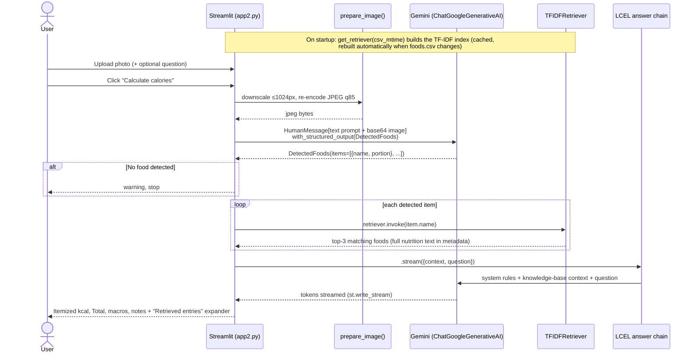
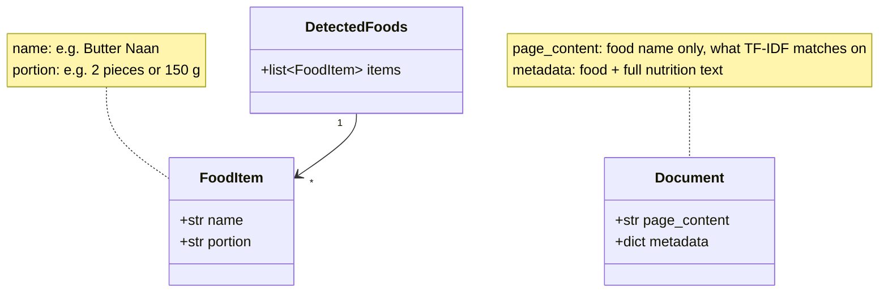

# AI Calorie Estimator (Multimodal RAG): Project Summary & Interview Guide

**Live app:** https://calorie-detection-using-langchain.streamlit.app/
**Stack:** Python · LangChain (LCEL) · Google Gemini vision (`gemini-3.5-flash` via `langchain-google-genai`) · Pydantic · LangChain `TFIDFRetriever` (scikit-learn) · Pandas · Pillow · Streamlit Cloud
**Main file:** [app2.py](app2.py) (LangChain + RAG version) · [app.py](app.py) is the original plain-Gemini version

---

## 1. The 30-second pitch

> "I built a multimodal RAG app that estimates calories from a meal photo. It works in three steps. First, a **vision LLM** (Gemini, called through LangChain) identifies each food item and its portion and returns **structured output validated by Pydantic**. Second, each item is looked up in a **nutrition knowledge base** of 166 foods using a local **TF-IDF retriever**. Third, an **LCEL chain** (`prompt | llm | parser`) calculates calories **only from the retrieved facts**, scales them to the portion and **streams** the answer. I also tuned latency: the response time dropped about 3x, from 9.0s to 2.7s."

**Why not just ask the LLM "how many calories?"** That was version 1 ([app.py](app.py)). The numbers were inconsistent and impossible to verify. Version 2 separates **perception** (what's on the plate) from **facts** (calories per serving, from a trusted dataset) and **reasoning** (scaling to the portion). This is the core idea of RAG: grounded, explainable, consistent answers.

---

## 2. Low-Level Design (LLD)

### 2.1 Request flow (sequence diagram)

### 2.2 Data models (Pydantic → structured output)

### 2.3 Code map (click to jump to the code)

| What | Where | Key detail |
|---|---|---|
| Config | [app2.py:49-52](app2.py#L49-L52) | `CHAT_MODEL`, `TOP_K = 3`, `MAX_IMAGE_SIDE = 1024`, 60s timeout |
| LLM client (cached) | [app2.py:59-68](app2.py#L59-L68) `get_llm()` | `temperature=0.2`, **`thinking_budget=0`**, `timeout`, `max_retries=1` |
| CSV → Documents | [app2.py:75](app2.py#L75) `load_food_documents()` | `page_content` = food name only; full facts in `metadata["text"]` |
| Retriever (cached on file mtime) | [app2.py:95-104](app2.py#L95-L104) `get_retriever()` | `char_wb` n-grams (2-4): "naan" matches "Butter Naan" |
| Output schema | [app2.py:114-120](app2.py#L114-L120) | `FoodItem`, `DetectedFoods` (Pydantic) |
| Image preprocessing | [app2.py:132](app2.py#L132) `prepare_image()` | RGB, thumbnail to 1024px, JPEG q85 |
| Vision step | [app2.py:142-152](app2.py#L142-L152) `detect_foods()` | Multimodal `HumanMessage` + `.with_structured_output()` |
| Retrieval step | [app2.py:164](app2.py#L164) `retrieve_context()` | One retriever call per item → context string + UI hits |
| Grounding prompt | [app2.py:179](app2.py#L179) `ANSWER_PROMPT` | "Calculate ONLY from the knowledge-base context…", mark estimates |
| LCEL chain | [app2.py:197](app2.py#L197) `build_answer_chain()` | `ANSWER_PROMPT | get_llm() | StrOutputParser()` |
| Streaming | [app2.py:253](app2.py#L253) | `chain.stream(...)` → `st.write_stream` |

---

## 3. Each step explained with LangChain terminology

| # | Step | LangChain concept | What to say in the interview |
|---|---|---|---|
| 1 | Call Gemini | **Chat Model** (`ChatGoogleGenerativeAI`) | "LangChain's provider-agnostic chat-model interface. I can switch Gemini for GPT-4o or Claude without touching the pipeline." |
| 2 | Send the image | **Multimodal message** (`HumanMessage` with text + `image_url` parts) | "One message carries the instruction and the base64-encoded image, which is how you do vision through LangChain." |
| 3 | Get typed data | **Structured output** (`.with_structured_output(PydanticModel)`) | "Instead of parsing free text with regex, I bind a Pydantic schema. The model returns validated `DetectedFoods` objects, so the downstream code is type-safe. Field descriptions act as instructions to the model." |
| 4 | Build the knowledge base | **Document** (`page_content` + `metadata`) | "Each CSV row becomes a Document. I index *only the food name* in `page_content` so matching isn't polluted by serving text, and keep the full nutrition line in `metadata`." |
| 5 | Look up foods | **Retriever** (`TFIDFRetriever`, k=3) | "A sparse, lexical retriever. Character n-grams handle partial names and spelling variants. It runs locally in milliseconds with no embedding API quota." |
| 6 | Prompt | **ChatPromptTemplate** (system + human, `{context}`, `{question}`) | "The system message sets strict grounding rules and the output format. Unknown foods must be flagged as estimates, so there are no silent hallucinations." |
| 7 | Compose | **LCEL** (`prompt | llm | parser`) | "The pipe operator chains Runnables. Every Runnable supports `.invoke`, `.batch` and `.stream`, so streaming came almost for free." |
| 8 | Parse | **Output Parser** (`StrOutputParser`) | "Extracts plain text from the model's `AIMessage` chunks, which is ideal for streaming into the UI." |
| 9 | Stream | **Streaming** (`.stream()` + `st.write_stream`) | "Tokens appear as they're generated, which improves perceived latency a lot." |

---

## 4. Design decisions & trade-offs

| Decision | Why | Trade-off / alternative |
|---|---|---|
| **Two LLM calls** (detect, then answer) instead of one | Separates perception from calculation; makes retrieval possible between them; each step can be debugged | Two network round trips (offset by the latency tuning below) |
| **Pydantic structured output** | Reliable, typed hand-off between steps; no fragile text parsing | Needs a model that supports tool / JSON calling |
| **TF-IDF (sparse) instead of dense embeddings** | Food names are short keywords, so lexical matching works well. It's local, instant and free, and the free embedding tier allows only about 100 requests per minute with a network call each | Can't match synonyms ("curd" ≠ "yogurt"). Fix: hybrid BM25 + dense with an `EnsembleRetriever` |
| **Character n-grams (`char_wb`, 2-4)** | Robust to partial names, plurals and typos | A bigger vocabulary (trivial at 166 rows) |
| **Index only the food name** | Precision: serving / notes text would add noise to matching | Metadata must carry the full text |
| **Cache the retriever keyed on CSV modified time** | Built once, auto-rebuilt when the knowledge base is edited, with no restart | In-memory only |
| **`thinking_budget=0`** | Skips the model's internal reasoning pass: **9.0s → 2.7s (~3x)** | Slightly less reasoning on hard images (acceptable for this task) |
| **Image downscale to 1024px JPEG** | Smaller upload means faster requests | Very fine detail lost (irrelevant for food recognition) |
| **`temperature=0.2`** | Consistent, repeatable numbers | Less "creative" text (desired) |

---

## 5. Challenges I solved (good STAR stories)

1. **Inconsistent calorie numbers (v1 → v2):** the plain vision prompt ([app.py](app.py)) gave different numbers for the same photo. *Fix:* redesigned it as RAG with a curated nutrition knowledge base, a prompt that allows calculation only from retrieved facts, and visible retrieved entries for transparency.
2. **Latency:** the first version took about 9 seconds. *Fix:* profiled with logging, set `thinking_budget=0`, downscaled images, used local retrieval and streamed the answer. Result: **~2.7s**, about 3x faster, and the first tokens appear almost immediately.
3. **Silent hangs:** the gRPC transport of the old SDK hung with no output, and empty text parts made the API stall. *Fix:* REST transport, explicit timeouts, `max_retries=1`, filtering out empty prompt parts, and structured logging.
4. **Model availability:** newer Gemini versions timed out for this key. *Fix:* the model is a single config constant, so switching is easy.
5. **Unreliable parsing:** replaced free-text parsing with Pydantic **structured output**.
6. **Edge cases:** no food in the image → friendly warning; a food not in the knowledge base → the model must label it "(estimate, not in knowledge base)".

---

## 6. Limitations & how I'd improve it

- **Portion estimation** from a 2D photo is the biggest error source. Ideas: a reference object, depth estimation, or asking the user to confirm portions.
- **Hybrid retrieval:** TF-IDF/BM25 + dense embeddings for synonyms and regional names.
- **Bigger, authoritative knowledge base** (USDA / IFCT India) in a vector DB with metadata filtering (cuisine, category).
- **Agentic flow:** a LangGraph agent with tools (search the knowledge base, ask the user to clarify portions, a calculator for exact arithmetic).
- **Evaluation:** a labelled image set; measure detection accuracy and calorie MAE, and track RAG faithfulness.
- **Personalization:** daily goals, meal history, diet preferences.

---

## 7. Likely interview questions (with short answers)

**Q: Why is this RAG if you don't use a vector database?**
RAG means *retrieve then generate*. The retriever can be dense (embeddings), sparse (TF-IDF/BM25) or hybrid. For short keyword-like food names, sparse retrieval is the better and cheaper choice.

**Q: TF-IDF vs embeddings?**
TF-IDF scores exact term (or n-gram) overlap, weighted by rarity. It's fast, explainable and has no model. Embeddings capture *meaning* (synonyms, paraphrases). Production systems often combine them (hybrid search).

**Q: What does `with_structured_output` do under the hood?**
It converts the Pydantic schema into a tool/function or JSON schema for the model, then parses and validates the response back into the Pydantic object.

**Q: What is LCEL and why use it?**
Declarative composition with `|`. Each piece is a Runnable, so you get `.invoke`, `.stream`, `.batch` and async uniformly, plus easy swapping and tracing (LangSmith).

**Q: How do you prevent hallucinated calorie values?**
Grounding instructions, retrieved facts in the prompt, mandatory "estimate" labels for unknown foods, low temperature, and showing the retrieved entries to the user.

**Q: How did you measure the latency improvement?**
Timing logs around each step (`time.time()` and the `logging` module). The detection call went from 9.0s to 2.7s after setting `thinking_budget=0`.

**Q: How would you scale it?**
Move the knowledge base to a managed vector / hybrid store, run the pipeline behind a FastAPI service, cache results by image hash, and add rate limiting and monitoring.

---

## 8. Quick glossary

| Term | One-liner |
|---|---|
| Multimodal LLM | A model that accepts images and text together |
| Structured output | The LLM returns data matching a schema (Pydantic / JSON) |
| Sparse retrieval | Keyword / n-gram matching (TF-IDF, BM25) |
| Dense retrieval | Embedding-vector similarity search |
| LCEL | LangChain Expression Language: `prompt | llm | parser` |
| Runnable | The common LangChain interface: `invoke` / `stream` / `batch` |
| Output parser | Converts raw model output into a usable format |
| Grounding | Restricting answers to the provided facts |
| Streaming | Sending tokens to the UI as they're generated |
